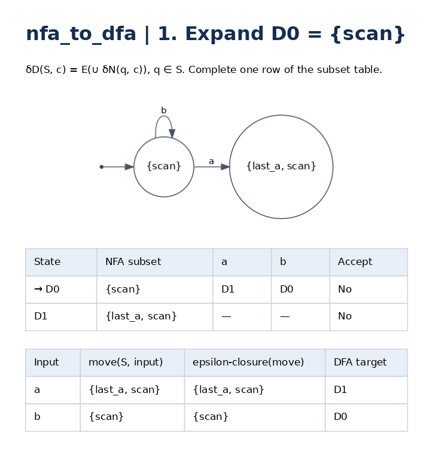
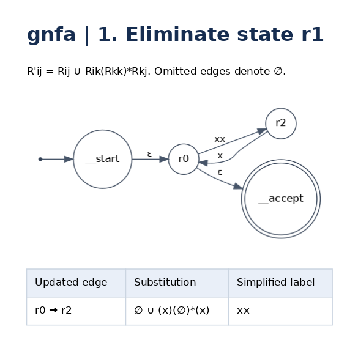

<p align="center">
  
</p>
<h1 align="center">FLARE</h1>
<p align="center"><strong>계산이론의 작은 아이디어에 불을 붙이다.</strong><br />Formal Languages · Automata · Reasoning · Experiments</p>

FLARE는 **정의하고, 예상하고, 실행하고, 왜 그런지 설명하는** 계산이론 실험실입니다. Python으로 작은 머신이나 정규표현식을 작성하면 상태도, 전이표, 변환 과정이 PNG로 나옵니다. 서로 다른 두 풀이를 비교하면 같은 언어인지 판정하고, 다르면 가장 짧은 반례를 찾아줍니다.

상태 두 개로 짝수를 기억하는 것부터 시작해, 비결정성의 제거와 정규 언어의 닫힘 성질, 최소 상태 수의 논증, Kleene 정리의 구성적 변환, Pumping Lemma를 이용한 비정규성 증명까지 따라갈 수 있습니다.

## 왜 코드로 공부하나요?

책에서 `δD(S, a) = E(⋃ δN(q, a))`를 읽었다면, 이제 **S에 실제로 무엇이 들어가는지** 확인할 차례입니다.

- **머신을 설계할 때:** 상태 이름에 기억해야 할 정보를 붙이고, 표와 그림이 의도와 맞는지 확인합니다.
- **변환을 배울 때:** 완성된 답만 보는 대신 부분집합 한 행, 정규표현식 연산 하나, 제거한 상태 하나를 따라갑니다.
- **풀이가 의심될 때:** “몇 개 넣어보니 맞는다”를 넘어 두 머신의 언어를 정확하게 비교합니다. 틀린 경우 반례가 오해를 드러냅니다.
- **증명을 배울 때:** 불변식, 귀납, 구별 가능한 접미사, 양화 순서를 실행 가능한 대상과 연결합니다.
- **수업 자료를 만들 때:** 입력을 바꾸고 다시 실행해 같은 형식의 그림과 표를 얻습니다. PNG를 문서나 슬라이드에 사용할 수 있습니다.

예를 들어 `a*(b∪c)`와 `a*b∪c`는 비슷해 보이지만, `ac`가 둘을 구별합니다. [06번 예제](examples/06_find_the_bug.py)는 반례를 구하고 잘못 적용한 분배법칙을 고치는 짧은 실험입니다.

## 3분 안에 첫 그림 만들기

Python **3.10 이상**, Graphviz의 **`dot` 실행 파일**이 필요합니다. Python 패키지 `graphviz`와 시스템 Graphviz는 별도로 설치합니다.

```bash
# Ubuntu / Debian
sudo apt install graphviz python3-venv

# macOS에서는 위 명령 대신: brew install graphviz
# Windows에서는 Graphviz를 설치한 뒤 bin 디렉터리를 PATH에 추가합니다.
dot -V

python3 -m venv .venv
source .venv/bin/activate
# Windows PowerShell: .venv\Scripts\Activate.ps1

python -m pip install -e .
python examples/01_two_states.py
```

`outputs/01_two_states/machine.png`를 열어 보세요. 시작 상태가 수락 상태인 이유는 **0번도 짝수이기 때문**입니다. 이제 `accepting={'even'}`을 `{'odd'}`로 바꾸고 다시 실행해 보세요. 예제의 검증식도 새 조건에 맞게 바꿔야 합니다.

## 예제: 작은 질문에서 정리까지

각 파일은 **독립적으로 실행하는 짧은 Python 스크립트**입니다. 별도의 러너나 숨겨진 공통 설정이 없습니다. 위에서부터 입력 → 계산 → 그림 → 확인 순서로 읽으면 됩니다. 한글 주석에는 설계 이유와 직접 바꿔 볼 질문을 넣었습니다.

| 순서 | 질문 | 배우는 것 |
| --- | --- | --- |
| [01 · 상태 두 개](examples/01_two_states.py) | 지금까지 읽은 것을 얼마나 기억해야 할까? | 상태의 의미, 시작/수락 상태, 빈 문자열 |
| [02 · 이진수 나머지](examples/02_binary_remainders.py) | 큰 수를 저장하지 않고 배수를 판별할까? | `r → (2r+bit) mod m`, 불변식 |
| [03 · 비결정성](examples/03_nondeterminism.py) | 여러 추측을 하나의 상태로 표현할까? | NFA→DFA, 부분집합 구성과 표 |
| [04 · ε와 ∅](examples/04_epsilon_is_not_empty_set.py) | 아무것도 읽지 않음과 아무것도 없음은 같은가? | ε-closure, 빈 단어와 빈 언어 |
| [05 · Thompson 구성](examples/05_thompson_construction.py) | 식의 연산을 머신으로 조립할까? | 합집합·연결·star, 구조적 귀납의 불변식 |
| [06 · 반례로 디버깅](examples/06_find_the_bug.py) | 그럴듯한 두 식이 정말 같은가? | 정확한 동치 판정, 최단 반례, 분배법칙 |
| [07 · 최소 상태 수](examples/07_why_two_states_are_necessary.py) | 충분하다는 것과 꼭 필요하다는 것은 어떻게 다른가? | 최소화, 구별 접미사, Myhill–Nerode의 관점 |
| [08 · 상태 제거](examples/08_state_elimination.py) | 사라진 상태를 어떻게 식에 남길까? | GNFA, 경로 불변식, 제거 순서 |
| [09 · 닫힘 성질](examples/09_closure_under_intersection.py) | 두 조건을 동시에 검사할까? | 곱 구성으로 교집합, 완전 DFA의 여집합 |
| [10 · Kleene 정리](examples/10_kleene_round_trip.py) | 정규표현식과 머신 사이를 왕복할까? | Regex→NFA→DFA→Regex, 두 방향의 구성 |
| [11 · 비정규성 증명](examples/11_nonregular_language.py) | 왜 aⁿbⁿ에는 유한 상태가 부족할까? | Pumping Lemma, 모든 유효 분할에 대한 논증 |
| [12 · 실험과 증명](examples/12_experiments_are_not_proofs.py) | 작은 범위에서 맞으면 증명인가? | 유한 탐색의 한계, `unknown`과 `search_failed` |

원하는 파일 하나만 실행하면 됩니다.

```bash
python examples/03_nondeterminism.py
python examples/08_state_elimination.py
python examples/10_kleene_round_trip.py
```

출력은 항상 프로젝트의 `outputs/예제파일이름/`에 저장됩니다. 같은 예제를 다시 실행하면 같은 경로의 결과를 갱신합니다. 이전 실험을 보존하려면 코드 상단의 `OUTPUT`을 바꾸세요.

## 그림은 이렇게 읽습니다

**NFA→DFA:** 현재 상태도 아래에 누적 전이표와 `move → ε-closure` 계산이 붙습니다. 표의 `—`는 아직 계산하지 않은 칸, `{}`는 실제 빈 부분집합입니다.



**상태 제거:** 새 시작·종료 상태를 만든 뒤, 상태 하나를 제거할 때마다 한 장을 만듭니다. 바뀐 간선의 식과 단순화 결과가 함께 나옵니다.



**Regex→NFA:** 기호와 연산 하나마다 해당 부분식의 그림이 나옵니다. 마지막 그림이 전체 NFA입니다. 원래 구성을 보려면 `regex_to_nfa('∅*')`처럼 원래 문자열을 넘기세요. 미리 단순화한 AST에서는 사라진 연산을 복원할 수 없습니다.

`step_00.png`부터 차례로 읽으면 됩니다. `trace.json`은 더 깊게 확인하고 싶을 때 보는 전체 계산 기록입니다. 내부 연산 하나마다 그림이 필요할 때만 `result.export_png(path, detail='full')`을 사용하세요.

## 내 문제를 Python으로 작성하기

```python
from formal_language_engine import NFA, convert_nfa_to_dfa

# a 또는 b 중 딱 한 글자를 읽는 머신.
nfa = NFA(
    states={'start', 'done'},
    alphabet={'a', 'b'},
    initial='start',
    accepting={'done'},
    transitions={
        ('start', 'a'): {'done'},
        ('start', 'b'): {'done'},
    },
)

nfa.render_sheet('outputs/my_machine.png')  # 상태도 + 전이표
print(nfa.test('a'))                        # True
print(nfa.test('aa'))                       # False

result = convert_nfa_to_dfa(nfa)
result.export_png('outputs/my_conversion')
dfa = result.machine
assert nfa.equivalent_to(dfa)
```

| 하고 싶은 일 | 호출 |
| --- | --- |
| 상태도만 / 상태도와 표 | `machine.render(path)` / `machine.render_sheet(path)` |
| 문자열 수락 여부 | `machine.test(word)` |
| 문자열의 상태 전이 추적 | `machine.simulate(word)` |
| 정규표현식 → ε-NFA | `regex_to_nfa('(ab∪c)*')` |
| NFA / ε-NFA → DFA | `convert_nfa_to_dfa(machine)` |
| DFA 최소화 | `minimize_dfa(dfa)` |
| GNFA → 정규표현식 | `automaton_to_regex(machine, elimination_order=[...])` |
| 언어 동치 여부 / 최단 반례 | `a.equivalent_to(b)` / `a.find_counterexample(b)` |
| 형식적 조건 검사 | `machine.validate(exact_states=3, complete=True)` |
| 지원 언어의 pumping 증명 | `prove_nonregular(EqualBlocks())` |

알고리즘 함수는 `Result`를 반환합니다. 계산값은 `.value`, 머신은 `.machine`, 정규표현식은 `.regex`, 전체 기록은 `.trace`로 접근합니다. `export_png()`가 그림을 저장합니다. 계산만 할 때는 PNG를 만들 필요가 없습니다.

입력 규칙도 단순합니다.

- DFA 전이의 도착지는 `'q1'` 하나, NFA는 `{'q1', 'q2'}` 같은 집합입니다. `NFA`는 ε 전이도 지원합니다.
- ε 전이는 `'ε'`로 씁니다. 정규표현식은 `∪` 또는 `|`, 연결, `*`, 괄호, `ε`, `∅`를 지원합니다.
- 부분 DFA에서 누락 전이는 거부를 의미합니다. 여집합을 만들 때는 완전성이 중요합니다. 최소화는 필요한 sink를 포함한 최소 완전 DFA를 반환합니다.
- `find_counterexample()`의 결과가 `None`이면 동치입니다. `''`는 **빈 문자열 반례**이므로 `if word`로 판별하면 안 됩니다.
- 여러 글자인 alphabet 기호는 `['open', 'close']` 같은 토큰 목록으로 입력합니다. 이때 최단 반례는 토큰 수 기준입니다.
- 텍스트 머신 정의도 `parse_machine(json_text)`로 읽을 수 있습니다. 형식은 `machine.to_json()`의 결과를 참고하세요.

## 어디까지가 증명인가요?

FLARE는 서로 다른 수준의 근거를 구분합니다.

| 근거 | 말할 수 있는 것 |
| --- | --- |
| 몇 개 문자열의 수락 결과 | 그 문자열들에 대한 관찰 |
| 도달 가능한 상태 쌍 전체의 동치성 검사 | 입력한 두 유한 오토마타의 언어가 같은지에 대한 정확한 판정 |
| 구성 알고리즘과 불변식·귀납 논증 | 구성적 정리가 왜 성립하는지 이해하는 근거 |
| 지원 스키마의 기호적 pumping certificate | 해당 언어에서 모든 p와 유효 분할을 다루는 비정규성 논증 |

**한 정규표현식의 왕복 변환을 실행했다고 Kleene 정리 전체를 자동 증명한 것은 아닙니다.** 예제의 주석은 기초 사례와 귀납 단계, 경로 불변식 등 일반 논증을 설명합니다. FLARE는 그 논증이 다루는 실제 구성을 보여주고, 개별 결과를 검증하는 도구입니다. Myhill–Nerode 예제 역시 구체적인 언어의 최소 상태 수를 논증하며, 정리 전체를 형식화한 증명기는 아닙니다.

Pumping Lemma 엔진은 현재 `EqualBlocks(a,b)`와 `RepeatedWord(alphabet,k)`의 명시적인 기호적 증명 스키마를 지원합니다. 신뢰 기반은 `formal_language_engine/proof/symbolic_verifier.py`에 있는 수학적 스키마이며, 외부 정리 증명기를 사용하는 범용 증명 엔진은 아닙니다. 임의 언어의 소속 판정 함수를 입력한 경우에는 유한 탐색만 수행합니다.

- `proven`: 지원하는 보편적 기호 논증이 검증되었습니다.
- `unknown`: 유한한 증거만 있거나 탐색 예산이 끝났습니다.
- `search_failed`: 주어진 범위에서 witness를 찾지 못했습니다. 정규성 증명이라는 뜻은 아닙니다.

자연어 문제의 자동 해석, 임의 정리의 자동 증명, 문맥자유 문법·PDA·튜링 머신은 현재 범위에 포함하지 않습니다. 부분집합 구성은 지수적으로 커질 수 있고 GNFA 식과 전체 Trace도 커질 수 있으므로 작은 머신에서 시작하는 것이 좋습니다.